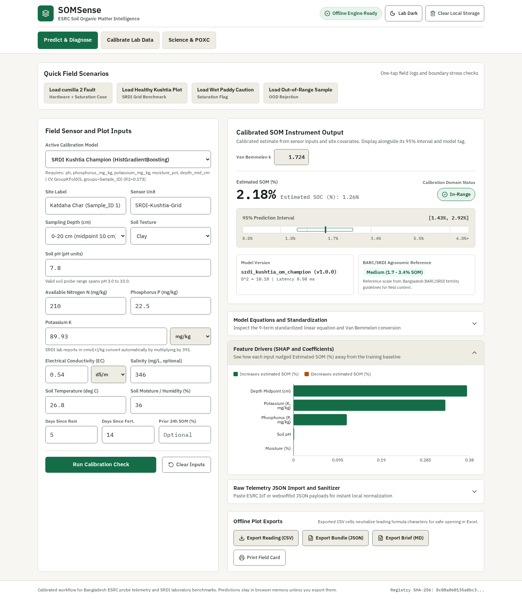
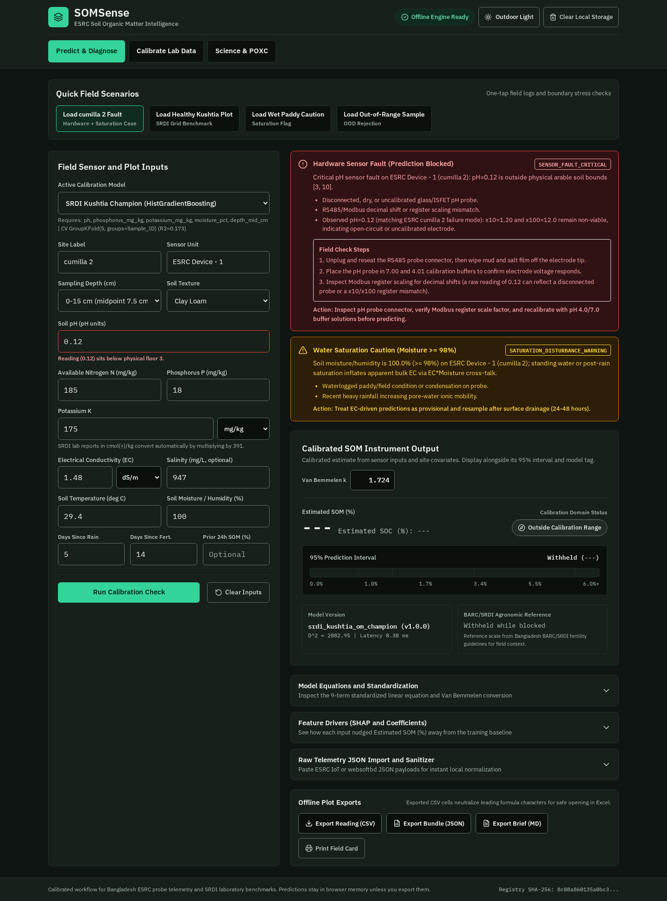
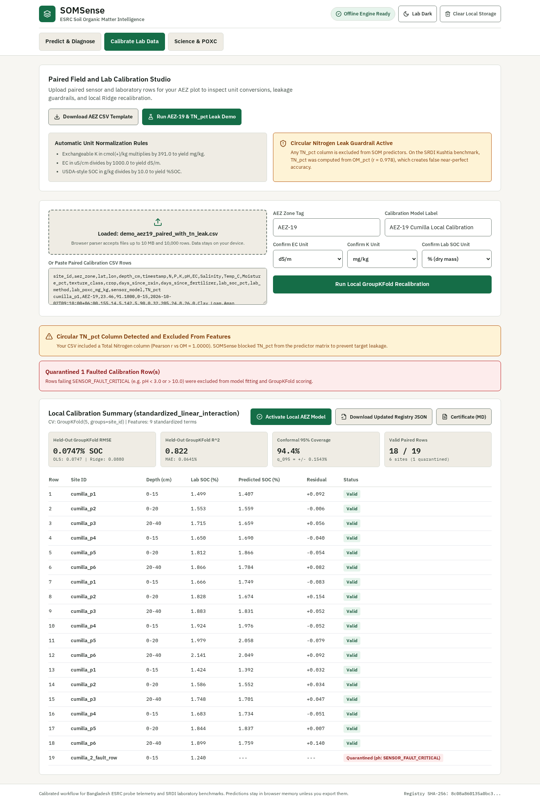
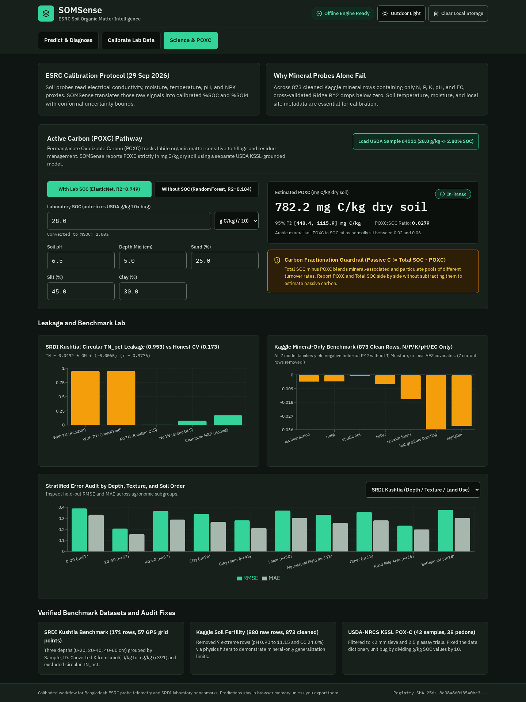
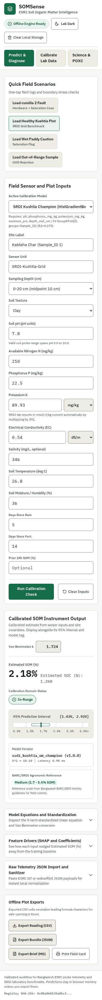

# SOMSense: ESRC Soil Organic Matter Intelligence

**Calibrated, offline-first estimation of Soil Organic Matter (`%SOM`), Soil Organic Carbon (`%SOC`), and Active Carbon (`POXC`, `mg C/kg dry soil`) with conformal 95% prediction intervals and hardware fault protection.**

Built around Dr. Fizar Ahmed's ESRC technical calibration pathway (29 Sep 2026) for Bangladesh field sensing at `$0/month` infrastructure cost. Multi-parameter RS485 soil probes read electrical conductivity, dielectric moisture, temperature, pH, and derived ion proxies rather than solid-phase organic matter directly. SOMSense never displays raw sensor outputs as `%OM`. Every prediction pairs `Estimated SOM (%)` alongside a `95% Prediction Interval`, an active `Model Version`, and a checked `Calibration Domain Status` (`In-Range`, `Caution`, or `Outside Calibration Range`).



## Key Engineering Guarantees

1. **Zero Silent Probe Faults**: Real telemetry from `ESRC Device - 1` at `cumilla 2` captured `pH = 0.12` alongside `Humidity = 100%`. Values outside `[3.0, 10.0]` pH raise `SENSOR_FAULT_CRITICAL`, halt numeric prediction, and surface step-by-step Modbus/buffer troubleshooting instead of feeding broken voltages into regression weights.
2. **Spatial Cross-Validation Without Leakage**: Multi-depth cores from one GPS coordinate never split across training and validation sets (`GroupKFold` grouped by `Sample_ID`, `Pedon_ID`, or `site_id`), and preprocessing scalers, conformal quantiles, and Mahalanobis covariance fit strictly inside training folds.
3. **Sub-`1e-12` Python-to-Browser Parity**: Python exports coefficients, flat float32/float64 decision trees, conformal `q_095` brackets, and regularized Mahalanobis inverse covariance matrices into [models/registry.json](models/registry.json) (`389,139` bytes). Client-side TypeScript verifies canonical `SHA-256` via WebCrypto and executes predictions under `50 ms` locally (`<= 4.55e-13` max numerical difference vs Python).
4. **Offline-First PWA with `$0/Month` Hosting**: Static HTML, JavaScript, self-hosted fonts (`IBM Plex Sans`, `IBM Plex Mono`, `Noto Sans Bengali`), and model weights run behind a strict Content Security Policy and Service Worker cache without cloud servers or API keys.
5. **Isolated Active Carbon Track**: Permanganate-oxidizable carbon (`POXC`) runs on its own pipeline strictly in `mg C/kg dry soil`, blocking invalid `Passive C = Total SOC - POXC` mass-balance subtraction.



## Real Public Datasets and Scientific Bugs Resolved

All benchmarks train on verified public repositories cataloged in [data/manifest.json](data/manifest.json) and [DATA_PROVENANCE.md](DATA_PROVENANCE.md). Auditing raw tables exposed four domain traps built directly into automated guards:

- **SRDI Kushtia 2024 Floodplain Benchmark (`10.17632/frkzb57y7p.1`)**: `171` rows across `57` GPS points (`Sample_ID` 1 to 57) and three depths (`0-20`, `20-40`, `40-60 cm`). Exchangeable potassium converts from `cmol(+)/kg` to `mg/kg` (`* 391.0`). Crucially, `TN_pct` was computed arithmetically from organic matter (`TN = 0.0492 * OM - 0.0065`, `r = 0.9776`), inflating naive regression `R^2` to `0.953`. SOMSense strips `TN_pct` strictly from predictor sets (`0.1734` GroupKFold `R^2`).
- **Kaggle Soil Fertility Mineral Limit (`rahuljaiswalonkaggle/soil-fertility-dataset`)**: Seven out of `880` rows break soil chemistry bounds (`pH = 0.90`, `pH = 10.05-11.15`, `OC = 24.0%`, `Zn = 42.0`). Across the `873` clean mineral records containing only `N`, `P`, `K`, `pH`, and `EC`, held-out Ridge `R^2` drops to `-0.0042` (`OLS = -0.0044`). That negative result confirms Dr. Fizar's rule that mineral readings fail without temperature, moisture, and local site calibration.
- **USDA-NRCS KSSL POX-C Benchmark (`10.15482/USDA.ADC/1518679`)**: Fixes a `10x` unit labeling defect in `POXC_DataDictionary.csv` where `SOC` values stored in `g C/kg` were labeled `%` (verified on pedon `64511`, `SOC = 28.0 -> 2.80%`), isolates assays strictly to `< 2 mm Grind` at `2.5 g`, and excludes `4` reagent-exhausted `NaN` soils (`38` quantified samples across `35` pedons).
- **ESRC Device - 1 Field Artifacts (`cumilla 2`)**: Catches `Humidity >= 98%` saturation distortion (`SATURATION_DISTURBANCE_WARNING`), transient ion spikes (`TRANSIENT_ION_DISTURBANCE`), and `24 h` organic matter swings above `0.35%`.

## Verified Benchmark and Parity Metrics

Metrics below read directly from [models/artifacts_manifest.json](models/artifacts_manifest.json) (`canonical_payload_sha256: 8c08a860...64c97d5`).

| Model Track ID | Dataset & Target | Selected Family | Held-Out GroupKFold Metrics | 95% Conformal Coverage | Python-JSON Max Diff |
|---|---|---|---|---|---|
| `srdi_kushtia_om_champion` | SRDI Kushtia (`OM_pct`, `%`) | `hist_gradient_boosting` | `R^2 = 0.1734`, `RMSE = 0.3307%` | `96.5%` (`q_095 = 0.7476%`) | `1.55e-15` |
| `srdi_kushtia_om_baseline_ols` | SRDI Kushtia (`OM_pct`, `%`) | 9-term standardized OLS | `R^2 = 0.0742`, `RMSE = 0.3500%` | `97.1%` (`q_095 = 0.7552%`) | `2.22e-16` |
| `kaggle_mineral_oc_benchmark` | Kaggle Cleaned (`OC_pct`, `%`) | 5-term mineral OLS | `R^2 = -0.0044`, `RMSE = 0.2976%` | `95.6%` (`q_095 = 0.5235%`) | `1.11e-16` |
| `usda_kssl_poxc_with_soc` | USDA KSSL (`POXC`, `mg C/kg`) | `elastic_net` | `R^2 = 0.7487`, `RMSE = 149.47` | `97.4%` (`q_095 = 333.75`) | `2.27e-13` |
| `usda_kssl_poxc_without_soc` | USDA KSSL (`POXC`, `mg C/kg`) | `random_forest` | `R^2 = 0.1844`, `RMSE = 269.30` | `97.4%` (`q_095 = 715.82`) | `4.55e-13` |

<details>
<summary>Additional Screenshots: In-Browser AEZ Calibration, POXC Lab Charts, and Mobile Views</summary>

| AEZ-19 Calibration & Leak Guard (Light) | POXC Active Carbon & Leakage Lab (Dark) | Mobile Light Healthy Plot |
|---|---|---|
|  |  |  |

</details>

## Quickstart

### 1. Python ML Pipeline and Verification

Requires Python `>= 3.11` (verified on Python `3.15.2`). Run setup inside a local virtual environment:

```bash
python -m venv .venv
.venv/bin/pip install -e ".[dev]"

# Download CC-BY-4.0 SRDI Kushtia CSV and verify tracked USDA KSSL hashes
.venv/bin/python scripts/fetch_datasets.py --skip-kaggle
# Optional (requires KAGGLE_USERNAME and KAGGLE_KEY env vars for Kaggle 5-feature benchmark):
# .venv/bin/python scripts/fetch_datasets.py --verify-only

# Retrain all models, validate Python-JSON parity, and export models/registry.json
.venv/bin/python scripts/train_and_export.py

# Lint, strict typecheck, full 53-test suite, and CVE check
.venv/bin/ruff check ml_core scripts tests
.venv/bin/mypy ml_core scripts tests
.venv/bin/pytest -v
.venv/bin/pip-audit
```

### 2. Offline PWA Web App (`web_app/`)

Requires Node.js `>= 20`. All frontend dependencies install cleanly via `package-lock.json`:

```bash
cd web_app
npm ci

# Run strict typecheck, 24 unit/parity/security tests, and build dist/
npm run build
npx vitest run

# Run live Chromium E2E tests across Desktop (1440x900) & Mobile (390x844)
npx playwright install chromium
npx playwright test

# Serve production PWA locally
npm run preview
```

## Security and Privacy Posture

Detailed exploit proofs, patches, and fuzz tests live in [docs/04_SECURITY_REDTEAM_AUDIT.md](docs/04_SECURITY_REDTEAM_AUDIT.md).

- Prototype-pollution keys (`__proto__`, `constructor`, `prototype`), JSON nesting deeper than `32` levels, non-finite numbers (`NaN`, `Infinity`, `1e308`), and CSV files larger than `10 MB` or `10,000` rows abort before modeling.
- Exported CSV and Markdown briefs escape spreadsheet formula prefixes (`=`, `+`, `-`, `@`, tab, carriage return) and neutralize script payloads.
- All field calibration uploads stay inside browser memory and `localStorage` with a one-click `Clear Local Storage` wipe button in the app bar.
- Both `.venv/bin/pip-audit` (`108` packages) and `npm audit` (`300` packages) pass with `0` known vulnerabilities.

## Quad-Platform CI/CD and Zero-Cost Deployment

Preconfigured pipelines automate checks and static web deployment across four git platforms without cloud servers:

- **GitHub Actions & GitHub Pages**: [.github/workflows/ci-release.yml](.github/workflows/ci-release.yml) + [.github/dependabot.yml](.github/dependabot.yml)
- **GitLab CI & GitLab Pages**: [.gitlab-ci.yml](.gitlab-ci.yml)
- **Bitbucket Pipelines**: [bitbucket-pipelines.yml](bitbucket-pipelines.yml)
- **Synchronized Multi-Remote Release**: [scripts/release-all.sh](scripts/release-all.sh) runs every gate (`ruff`, `mypy`, `pytest`, `pip-audit`, dataset SHA-256 check, registry parity check, `tsc`, `vitest`, `npm run build`), packages checksummed archives (`dist/release-v1.0.0/`) ready for SourceForge FRS and platform releases, and validates `--dry-run` before touching remotes.

```bash
# Dry-run release validation prior to adding remote URLs
./scripts/release-all.sh --dry-run
```

## Repository Map and Technical Documentation

| Path | Contents | Link |
|---|---|---|
| `ml_core/` & `scripts/` | Physics guardrails, datasets, `GroupKFold`, conformal intervals, OOD, POXC, and training CLI | [ARCHITECTURE.md](ARCHITECTURE.md) |
| `web_app/` | React 18 + TypeScript PWA (`Predict & Diagnose`, `Calibrate Lab Data`, `Science & POXC`) | [docs/06_UX_PSYCHOLOGY_SPEC.md](docs/06_UX_PSYCHOLOGY_SPEC.md) |
| `models/` | Canonical verified `registry.json` and `artifacts_manifest.json` | [docs/contracts/model_registry_schema.json](docs/contracts/model_registry_schema.json) |
| `data/` | Dataset checksum manifest, 22-column Bangladesh AEZ template, and CI fixture | [FIELD_SAMPLING_PROTOCOL.md](FIELD_SAMPLING_PROTOCOL.md) |
| `notebooks/` | Reproducible executed research notebook (`SOMSense_ESRC_Research_Pipeline.ipynb`) | [DATA_PROVENANCE.md](DATA_PROVENANCE.md) |
| `docs/` | Background study (`01`), mental model (`02`), architecture (`03`), red-team (`04`), QA (`05`), UX (`06`) | [docs/05_QA_TEST_REPORT.md](docs/05_QA_TEST_REPORT.md) |

## License and Governance

Released under the [MIT License](LICENSE). See [SECURITY.md](SECURITY.md) for responsible disclosure, [CONTRIBUTING.md](CONTRIBUTING.md) for PR requirements, and [CHANGELOG.md](CHANGELOG.md) for `v1.0.0` release notes.
