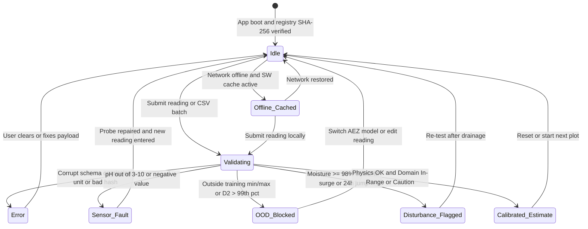

# SOMSense Product Mental Model, State Machines, and User Journeys

## 1. Instrument Mental Model

SOMSense operates as a fault-gated soil calibration instrument. Field probes measure electrical and thermal properties (`EC`, `Moisture`, `Temperature`, `pH`, and ionic `N`/`P`/`K`), yet organic carbon stays bound inside solid soil aggregates. Six deterministic gates therefore screen every input before any prediction reaches the display.

1. Parse and sanitize payload boundaries, rejecting prototype-pollution keys and neutralizing spreadsheet formula prefixes.
2. Normalize units explicitly (`K` in `cmol(+)/kg` multiplied by `391.0`, `EC` converted from `uS/cm` to `dS/m`, USDA KSSL `SOC` divided by `10`).
3. Enforce hardware and soil physics fault limits (`pH < 3.0` or `> 10.0`, negative nutrients, `Moisture > 100%`, `Temp < -10 C` or `> 60 C`).
4. Detect transient environmental disturbance (`Moisture >= 98%`, `EC > 2.0 dS/m` at `Moisture >= 70%`, 24-hour `%OM` jump `> 0.35`, or `C:N` outside `5-35`).
5. Score calibration domain boundaries via training min/max envelopes and regularized Mahalanobis distance ($D^2$).
6. Evaluate the verified model (`linear` or `tree_ensemble`), attach the conformal `95% Prediction Interval` clipped at zero, and display the `BARC/SRDI` agronomic reference badge.

Active carbon (`POXC` in `mg C/kg dry soil`) runs on an isolated modeling track that never merges with total carbon or reports `Passive C = Total SOC - POXC`.

## 2. Complete Application State Machine

Eight deterministic states govern the browser runtime across field and lab sessions.

| State | Entry Condition | Output & Prediction Visibility | Allowed User Actions |
| :--- | :--- | :--- | :--- |
| `Idle` | Initial boot online with verified `models/registry.json` (`SHA-256` valid). | Form ready with active `Model Version` pill and preset buttons. | Enter probe values, load presets, paste `ESRC Device - 1` JSON, upload lab CSV. |
| `Offline-Cached` | Browser offline (`navigator.onLine === false`) with Service Worker cache and `IndexedDB` state intact. | Offline indicator pill visible. Local inference stays sub-`50 ms`. | Run single predictions, calibrate local CSVs, export Markdown/CSV reports. |
| `Validating` | Any manual edit, preset click, JSON paste, or CSV batch submission triggers synchronous validation. | Brief transition (`< 5 ms`). No stale prediction left on screen. | Wait automatically for terminal gate state (`Calibrated-Estimate` or block state). |
| `Error` | `NaN`/`Infinity`, missing `EC` unit manifest, malformed CSV, `__proto__` key, or `SHA-256` mismatch. | Prediction hidden (`null`). Exact row, column, and cause printed. | Fix file or unit declaration, reload clean registry, clear form. |
| `Sensor-Fault` | `SENSOR_FAULT_CRITICAL`: `pH < 3.0` or `> 10.0` (e.g., `pH = 0.12`), negative minerals, `Moisture > 100%`, `Temp < -10 C` or `> 60 C`. | Red hardware block. Numeric `%SOM` withheld (`Blocked`). Shows Modbus shift and probe seat steps. | Inspect `ESRC Device - 1` wiring, clean electrode, recalibrate pH, re-test. |
| `OOD-Blocked` | Valid sensor physics, but any base feature falls outside training `[min, max]` or Mahalanobis $D^2 > D^2_{0.99}$. | Purple-free neutral/crimson border block showing `Outside Calibration Range` and offending features. No `%SOM` emitted. | Switch to matching AEZ model, open Lab CSV Calibration Studio, or inspect input values. |
| `Disturbance-Flagged` | `Moisture >= 98%` (e.g., `Humidity = 100%`), `EC > 2.0 dS/m` with `Moisture >= 70%`, rain/fert `< 3 days`, or `> 0.35%` 24h jump. | Amber caution card explaining `EC * Moisture` cross-talk. Outputs flagged interval with warning (or withheld under strict lock). | Mark field condition, wait for soil drainage, export flagged diagnostic trace. |
| `Calibrated-Estimate` | Passes physics, disturbance, and OOD checks (`In-Range` or boundary `Caution` between `D^2` 95th and 99th pct). | Shows `Estimated SOM (%)`, `+/- 95% PI` (lower bound `>= 0`), `Model Version`, `Domain Status`, `BARC/SRDI` tier, and SHAP bars. | Adjust `Van Bemmelen k`, export Markdown/CSV report, test next plot. |

Two gate boundaries hold unconditionally. `Sensor-Fault` stops prediction even when every other channel looks normal, because a disconnected pH electrode (`pH = 0.12` at `cumilla 2`) ruins standardized feature vectors and slopes. `OOD-Blocked` stops prediction whenever soil chemistry leaves the training envelope. Extrapolating a Kushtia alluvial clay model (`pH 6.9-8.0`, `OM 1.2-2.7%`) onto an acid hill plot (`pH 4.2`) fails silently unless blocked outright.

## 3. Four Grounded User Journeys

### Journey 1: Dr. Fizar Ahmed's ESRC Calibration Lab (Gazipur)

Dr. Fizar finishes drying 36 paired soil cores collected around `AEZ-19` alongside live telemetry from `ESRC Device - 1`, storing Walkley-Black titration values inside a CSV matching `esrc_aez_calibration_template.csv` (`days_since_rain`, `days_since_fertilizer`, `Temp_C`, `Moisture_pct`, and `lab_soc_pct`).

He opens `Calibrate Lab Data` on his desktop browser and drops in the file. The validator parses all 22 columns, flags two wet plots sampled one day after urea top-dressing (`days_since_fertilizer = 1`), and converts older SRDI potassium values from `cmol(+)/kg` using `391.0` after unit confirmation. Circular leaks fail fast. When an assistant leaves `TN_pct` inside a merged sheet, the studio blocks it immediately and cites the `r = 0.9776` Kushtia audit.

Browser training runs next. TypeScript executes `GroupKFold` across `site_id`, derives fold-only training means and standard deviations, fits the nine-term standardized linear+interaction equation (`N, P, K, pH, EC, T, M, z_T*z_M, z_EC*z_M`), and measures empirical `q_095` coverage. One plot carrying an uncalibrated `pH = 0.12` reading gets quarantined before fitting. Satisfied with the held-out `RMSE`, Dr. Fizar activates the local AEZ model and exports a signed JSON artifact plus Markdown summary.

### Journey 2: Md. Rafiqul Islam, Rural Field Technician (`cumilla 2`, `AEZ-19`)

Rafiqul reaches an Aman rice block near `cumilla 2` at 11:30 AM under bright sun and weak 2G signal. His Android phone opens SOMSense from the home-screen icon in `Offline-Cached` mode using warm limestone colors (`#F7F6F2` paper, `#141C17` ink) so readings stay legible in glare.

He pushes `ESRC Device - 1` into a flooded furrow and pastes the telemetry packet. Trouble hits at once. The app moves from `Validating` to `Sensor-Fault` (`SENSOR_FAULT_CRITICAL`) alongside `SATURATION_DISTURBANCE_WARNING`. High-contrast `IBM Plex Mono` numbers highlight `pH = 0.12` and `Humidity = 100%`, withhold `%SOM`, and instruct him to check the glass probe plug, wipe mud from the junction, and step out of standing water.

Rafiqul tightens a loose RS485 connector, wipes the tip, and samples the adjacent drained ridge (`example_cumilla_2_plot_a` template values: `N = 190`, `P = 19.5`, `K = 185`, `pH = 6.5`, `EC = 0.52 dS/m`, `Temp = 27.8 C`, `Moisture = 34.0%`). Latency stays invisible. Within `12 ms`, the screen enters `Calibrated-Estimate`, showing an illustrative `Estimated SOM: 2.03%` (`1.18% SOC * 1.724` plus local `95% PI`), `Calibration Domain Status: In-Range`, and a `BARC/SRDI: Medium (1.7-3.4%)` badge. He taps the `48 px` `Save Offline Report` button before walking on.

### Journey 3: Nusrat Jahan, Agronomy Graduate Student (BAU Mymensingh)

Nusrat needs verified methods and error bounds for her thesis comparing Kushtia soil organic matter with labile permanganate carbon. She opens SOMSense on her laptop in dark lab mode (`#0F1512`) and switches to `Science & POXC`.

She inspects the Kushtia 2024 panel first. Toggling SRDI's `TN_pct` leakage audit shows why keeping Kjeldahl nitrogen yields fake `R2` above `0.95` under random splits, while dropping `TN_pct` and grouping by `Sample_ID` across all 57 GPS coordinates exposes true spatial error and conformal `q_095` widths. Kaggle confirms the physics. Reading the cleaned 873-row 5-feature benchmark (`R2 = -0.0803`) gives her direct proof that mineral NPK+pH+EC readings need soil temperature and moisture context.

She then examines USDA KSSL `POXC`. Dividing `Table.S1` `SOC` by `10` corrects the `g C/kg` data dictionary error on sample `64511` (`28.0 -> 2.80% SOC`, `Ratio_poxc-soc = 0.042`), while the isolated `POXC (mg C/kg dry soil)` track enforces the guardrail blocking `Passive C = Total SOC - POXC`. Two clicks export her Markdown methods summary and stratified depth error CSV (`0-20`, `20-40`, `40-60 cm`) with `SHA-256` verification hashes intact.

### Journey 4: Edge-Case Red-Team Stress Tester

An engineer auditing SOMSense before release throws hostile payloads at `Predict & Diagnose` and the CSV uploader. First she pastes malformed JSON modeled on raw Kaggle outliers and injection vectors (`{"__proto__": {"polluted": true}, "PH": 11.15, "EC": 0.51, "OC": 24.0}`), verifying that prototype keys strip cleanly while `pH = 11.15` triggers `Sensor-Fault` (`pH > 10.0`) with zero exceptions.

Spreadsheet attacks follow. She uploads a CSV where `site_id` holds `=HYPERLINK("http://evil.invalid","cumilla 2")` and `EC` omits unit metadata (`620`). The importer stops in `Error` until an explicit `EC` unit is selected, and any downstream CSV export prefixes `=`, `+`, `-`, `@`, `\t`, or `\r` cells with a neutralizing apostrophe (`'=HYPERLINK(...)`).

Finally she tests valid chemistry from an acidic Sylhet hill plot (`pH = 4.2`, `P = 4.0 mg/kg`, `K = 65 mg/kg`, `Moisture = 28%`) against the Kushtia alluvial clay model (`pH 6.9-8.0`). Silent guessing stays off. Because `4.2` sits below the `6.9` floor and Mahalanobis $D^2$ passes the 99th-percentile threshold, SOMSense halts in `OOD-Blocked` and displays `Outside Calibration Range`.
