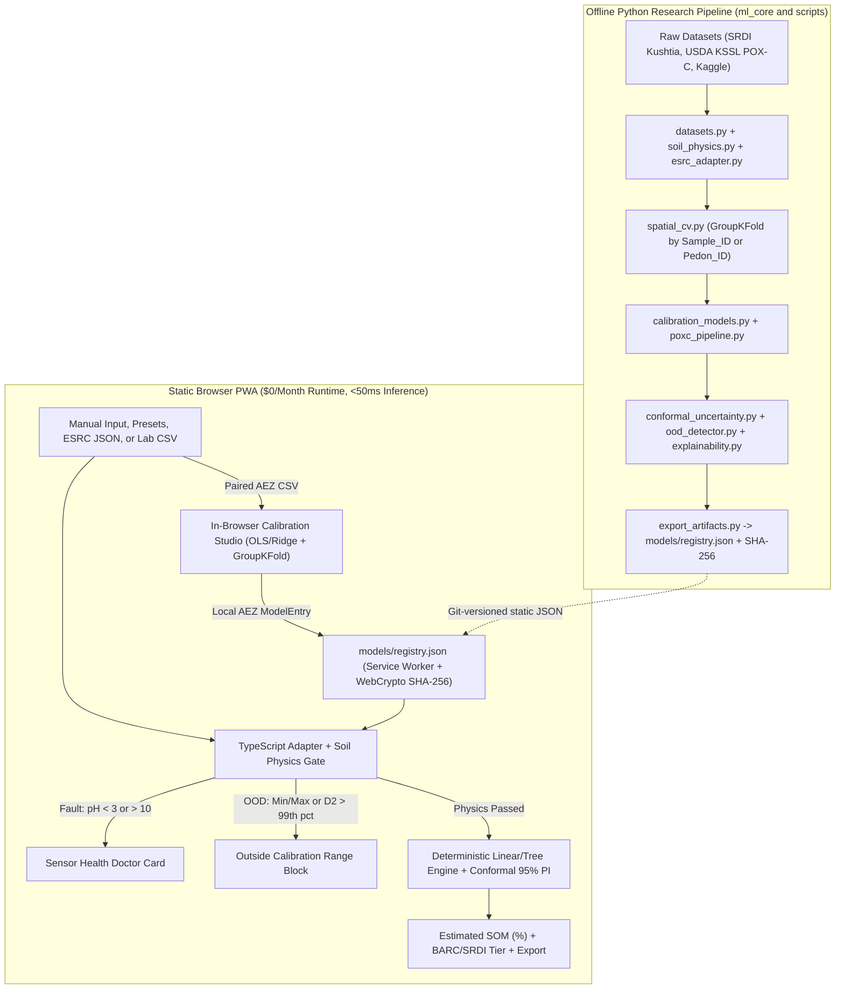

# SOMSense System Architecture, Engineering Upgrades, and Data Contracts

## 1. Two-Tier Zero-Backend Architecture

SOMSense separates offline Python training from static browser execution so field tablets run without cloud servers or ongoing API billing. Research pipelines validate datasets and export portable parameters into `models/registry.json` conforming strictly to [model_registry_schema.json](contracts/model_registry_schema.json). Zero servers sit in the middle. Static React and TypeScript assets verify those hashes locally via WebCrypto before running inference directly inside the browser.

## 2. Five Engineering Upgrades

### 2.1 Offline Browser Inference under 50 ms with Sub-1e-6 Parity

Every active model inside `models/registry.json` ships its complete math specification so the browser computes exact Python outputs locally. First, TypeScript standardizes raw inputs using training-fold means and standard deviations (`z_j = (x_j - mu_j) / s_j`) and builds any configured `z_product` interaction terms such as `z_T * z_M` and `z_EC * z_M` (applying optional `post_mean` and `post_std` when `restandardize` is true). Tree parity stays exact. Setting `feature_cast = "float32"` forces `Math.fround` inside flat-array browser tree routing (`children_left`, `children_right`, `feature`, `threshold`, `value`, and `missing_go_to_left`) so LightGBM, HistGradientBoosting, and RandomForest match Python within `1e-6`, while linear predictors evaluate a single dot product clipped at zero. Finally, the engine applies the configurable Van Bemmelen multiplier `k` (default `1.724` for `SOC_pct` or `OC_pct`), attaches the conformal `q_095` interval clipped at `0.0`, and scores domain safety from training `[min, max]` bounds plus regularized Mahalanobis distance $D^2 = (x - \mu)^T \Sigma_{reg}^{-1} (x - \mu)$. Typical execution takes under `5 ms` on mid-range Android devices.

### 2.2 Sensor Health Doctor

Real telemetry from `ESRC Device - 1` at `cumilla 2` (`pH = 0.12`, `Humidity = 100%`) proved that raw sensor streams mix catastrophic hardware faults with noisy moisture surges. Triage runs before prediction. Values outside physical bounds (`pH < 3.0` or `> 10.0`, negative `N`/`P`/`K`/`EC`/`Salinity`/`Moisture`, `Moisture > 100%`, `Temp < -10 C` or `> 60 C`, or non-finite inputs) raise `SENSOR_FAULT_CRITICAL`, block `%SOM`, and inspect `pH * 10` vs `pH * 100` to suggest disconnected probe vs Modbus decimal-shift recovery steps. Paired `EC` and `Salinity` values trigger `EC_SALINITY_MISMATCH` whenever `Salinity` diverges wildly from `0.5-0.7 * EC_uS_cm`. Valid physics readings that breach environmental thresholds (`Moisture >= 98%`, `EC > 2.0 dS/m` at `Moisture >= 70%`, rain or fertilization `< 3 days`, 24-hour `%OM` shifts `> 0.35`, or `C:N` outside `5-35`) raise amber disturbance warnings so pore-water ion spikes never pass unflagged.

### 2.3 In-Browser Lab CSV Calibration Studio

General soil probes gain local accuracy only when paired with regional laboratory truth. Dr. Fizar's team uploads a paired CSV following `esrc_aez_calibration_template.csv` into browser memory while keeping plot GPS coordinates off external servers. Unit confirmation comes first. The studio enforces explicit declarations (`cmol(+)/kg * 391.0` for SRDI `K`, `uS/cm -> dS/m`, `/ 10` for `g/kg` carbon), rejects `TN_pct` circular leaks automatically, quarantines `SENSOR_FAULT_CRITICAL` rows, groups splits by `site_id` (`GroupKFold`), solves the standardized nine-term Ridge or OLS equation via stable QR decomposition in TypeScript, estimates empirical conformal `q_095`, computes regularized Mahalanobis `inv_cov` bounds, and saves a `ModelEntry` conforming to [model_registry_schema.json](contracts/model_registry_schema.json).

### 2.4 Publication and Extension Report Exporter

Agronomists and students export reproducible outputs as Markdown briefs, schema-validated JSON bundles, or neutralized CSV logs. Every export carries `Estimated SOM (%)`, `Estimated SOC (%)`, the `95% Prediction Interval`, `Model Version`, `Calibration Domain Status`, `Van Bemmelen k`, `BARC/SRDI` fertility class, `artifact_sha256`, and all active fault flags. Spreadsheets stay safe. Cells in `site_id`, `device_id`, `crop`, or `notes` starting with `=`, `+`, `-`, `@`, `\t`, or `\r` receive a leading apostrophe before CSV download.

### 2.5 BARC/SRDI Fertility Scale and Isolated POXC Track

Upland Bangladesh agronomic guidelines classify soil organic matter across five tiers (`Very Low < 1.0%`, `Low 1.0-1.7%`, `Medium 1.7-3.4%`, `High 3.4-5.5%`, `Very High > 5.5%`). SOMSense displays this BARC/SRDI classification badge strictly as an agronomic reference next to the model's statistical `95% Prediction Interval` and `Calibration Domain Status`, keeping fertility tiers distinct from calibration uncertainty. Two carbon tracks never merge. Active permanganate-oxidizable carbon (`POXC` in `mg C/kg dry soil`) runs independently against USDA KSSL `< 2 mm Grind` at `2.5 g`, and `authority_protocol.forbid_passive_c_subtraction: true` prohibits computing `Passive C = Total SOC - POXC`.

## 3. Zero-Cost ($0/Month) Infrastructure Matrix

| Platform Layer | Chosen Technology | Monthly Cost | Capacity & Offline Guarantees |
| :--- | :--- | :--- | :--- |
| Static Web Hosting | GitHub Pages or Cloudflare Pages Free Tier | `$0` | Global CDN over HTTPS with zero server processes or cold starts |
| Inference Compute | Client-side TypeScript (linear + flat trees) | `$0` | `< 50 ms` local execution on mid-tier Android phones and laptops |
| Model Artifact Storage | Git-tracked `models/registry.json` (`< 2 MB`) | `$0` | Versioned with build-time `SHA-256` and verified via WebCrypto |
| Offline Persistence | Service Worker Cache + `IndexedDB` / `localStorage` | `$0` | Survives 2G/3G char-island blackouts and retains local AEZ models |
| Training & CI Verification | Local `.venv` / GitHub Actions Public Runner | `$0` | Reproducible `pytest`, `ruff`, `mypy`, and `nbconvert` execution |
| External Paid APIs | None (zero runtime LLM, weather, or DB calls) | `$0` | Eliminates API keys, quota exhaustion, and plot-privacy leaks |

## 4. Canonical Data Contracts

### 4.1 Model Registry JSON Contract (`models/registry.json`)

The canonical JSON Schema lives at [model_registry_schema.json](contracts/model_registry_schema.json) (`Draft 2020-12`). Every registry document declares `authority_protocol` (`k = 1.724`, `forbid_direct_sensor_om: true`, `forbid_passive_c_subtraction: true`), `hardware_physics_guardrails` matching `soil-physics-validator`, `models` keyed by lowercase track ID, `leakage_and_quality_audits`, and `integrity`. Hashes guard every build. Integrity verification hashes the compact UTF-8 JSON representation of all root keys excluding `integrity` (`sort_keys=True`, `separators=(",", ":")`) with `SHA-256` into `integrity.canonical_payload_sha256`, while each `ModelEntry` carries its own deterministic `artifact_sha256`. Any model failing `beats_ols_baseline` on held-out `GroupKFold` sites stays marked `baseline_ols`, `benchmark_reference`, or `rejected_under_baseline` rather than `selected_champion`.

### 4.2 ESRC IoT Telemetry JSON Contract (`ESRC Device - 1`)

Incoming JSON telemetry from `iot.websoftbd.net` or manual technician pastes accepts either a single object or an array of up to `10000` objects (`<= 10 MB` upload cap). Malicious payloads abort early. Prototype-pollution keys (`__proto__`, `constructor`, `prototype`) strip prior to field mapping, non-plain top-level values fail in `Error`, and `NaN` or `Infinity` literals reject immediately. Field names normalize case-insensitively across documented aliases (`Temperature`/`Temp_C`/`temp` -> `temperature_c` in `C`, `Humidity`/`Moisture`/`Moisture_pct` -> `moisture_pct` in `%`, `PH`/`pH`/`ph` -> `ph`, `Nitrogen`/`N` -> `nitrogen_mg_kg`, `Phosphorus`/`P` -> `phosphorus_mg_kg`, `Potassium`/`K` -> `potassium_mg_kg`, `Salinity`/`salinity_mg_l` -> `salinity`, `device_id`/`Device` -> `device_id`, `site_id`/`site`/`location` -> `site_id`, and `timestamp`/`created_at` -> ISO-8601 string). Electrical conductivity (`EC`, `ec_us_cm`, `ec_ds_m`) demands an explicit `unit_manifest` (`"dS/m"`, `"mS/cm"`, or `"uS/cm"`) or firmware profile before conversion, preventing silent `1000x` unit errors.

### 4.3 ESRC AEZ Paired Calibration CSV Contract

Lab calibration uploads follow the 22-column structure verified in [esrc_aez_calibration_template.csv](../data/templates/esrc_aez_calibration_template.csv), enforcing upload limits (`<= 10 MB`, `<= 10000` rows) and blocking `TN_pct` circular leaks (`r = 0.9776` in Kushtia).

| Column | Type | Canonical Unit / Format | Validation & Physics Rule |
| :--- | :--- | :--- | :--- |
| `site_id` | string | ASCII/UTF-8 identifier | Required group key for `GroupKFold`, formula-sanitized on export |
| `aez_zone` | string | e.g. `AEZ-19` | Required AEZ tag, formula-sanitized on export |
| `lat` | float | Decimal degrees | Optional latitude (`-90..90`) |
| `lon` | float | Decimal degrees | Optional longitude (`-180..180`) |
| `depth_cm` | string | e.g. `0-15`, `0-20` | Mapped to numeric `depth_mid_cm` when present |
| `timestamp` | string | ISO-8601 (`+06:00` or `Z`) | Validated timestamp driving 24h stability check (`> 0.35%` SOM jump) |
| `N` | float | `mg/kg` | Finite and `>= 0`, negative trips `SENSOR_FAULT_CRITICAL` |
| `P` | float | `mg/kg` | Finite and `>= 0`, negative trips `SENSOR_FAULT_CRITICAL` |
| `K` | float | `mg/kg` (`cmol(+)/kg * 391`) | Finite and `>= 0`, explicit unit manifest required before conversion |
| `pH` | float | pH units | Finite, `< 3.0` or `> 10.0` trips `SENSOR_FAULT_CRITICAL` |
| `EC` | float | `dS/m` (`uS/cm / 1000`) | Finite and `>= 0`, explicit unit manifest required (`uS/cm` vs `dS/m`) |
| `Salinity` | float | `mg/L` (optional) | Finite and `>= 0`, cross-checked against `0.5-0.7 * EC_uS_cm` |
| `Temp_C` | float | Degrees Celsius | Finite, `< -10` or `> 60` trips `SENSOR_FAULT_CRITICAL` |
| `Moisture_pct` | float | `%` (`0..100`) | `< 0` or `> 100` trips fault, `>= 98` trips saturation warning |
| `texture_class` | string | USDA/SRDI class | Optional categorical stratum, formula-sanitized on export |
| `crop` | string | Crop name | Optional agronomic context, formula-sanitized on export |
| `days_since_rain` | float | Days (`>= 0`) | Optional, `< 3` with high EC flags `TRANSIENT_ION_DISTURBANCE` |
| `days_since_fertilizer` | float | Days (`>= 0`) | Optional, `< 3` with high EC flags `TRANSIENT_ION_DISTURBANCE` |
| `lab_soc_pct` | float | `%` dry soil mass | Required calibration target (`>= 0`, `<= 40` mineral guard) |
| `lab_method` | string | e.g. `Walkley-Black` | Required provenance label (`k` sensitivity metadata) |
| `lab_poxc_mg_kg` | float | `mg C/kg dry soil` | Optional isolated POXC target (`>= 0`, never subtracted from SOC) |
| `sensor_model` | string | e.g. `ESRC Device - 1` | Preserved raw hardware label for technician diagnostics |
